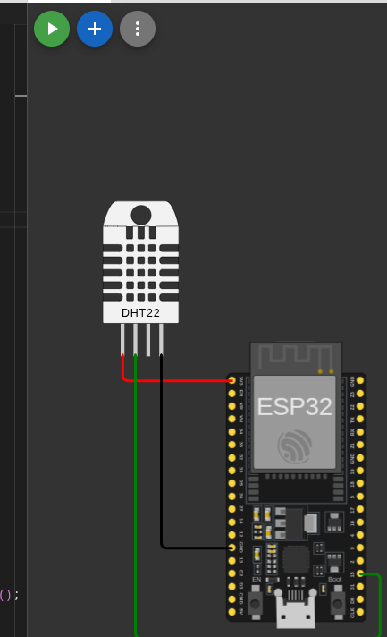
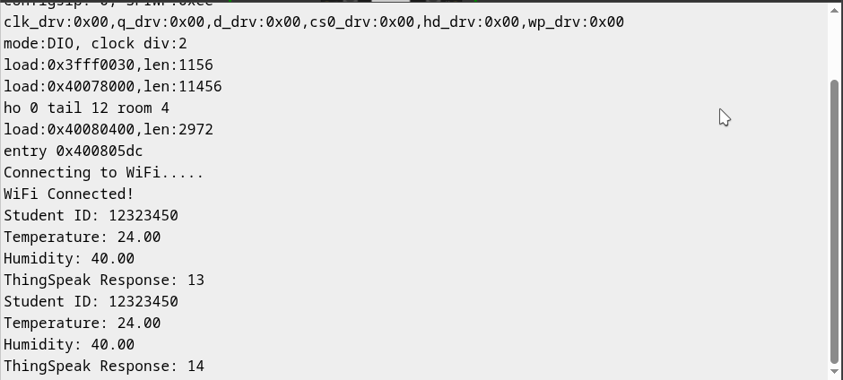
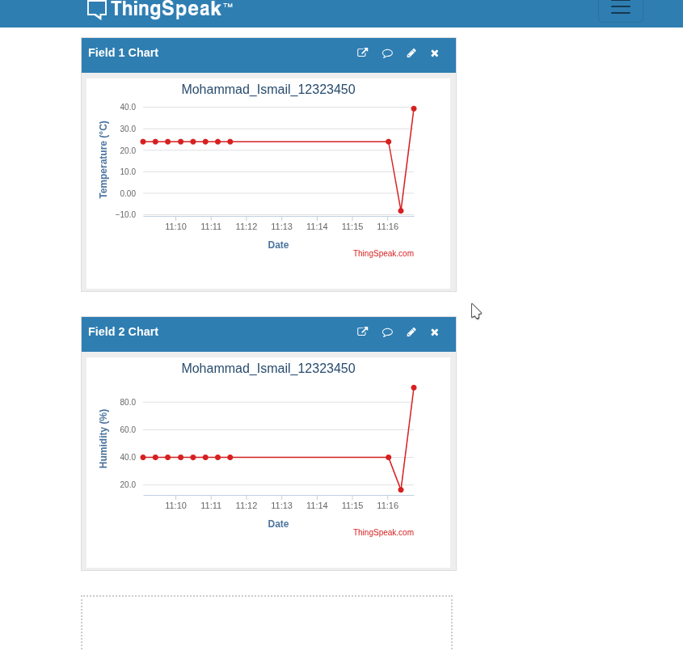

# ESP32 Temperature and Humidity Monitoring Using ThingSpeak

## Student Information

- **Student Name:** Mohammad Ismail
- **Student ID:** 12323450

## Project Description

This project uses an ESP32 microcontroller and a DHT22 sensor to monitor temperature and humidity.

The ESP32 connects to Wi-Fi and sends sensor readings to the ThingSpeak IoT platform every 20 seconds.

ThingSpeak stores the readings and displays them using real-time charts.

## Components

- ESP32 Development Board
- DHT22 Temperature and Humidity Sensor
- Jumper Wires
- Wi-Fi Connection
- ThingSpeak IoT Platform

## Circuit Connections

| DHT22 Pin | ESP32 Pin |
|---|---|
| VCC | 3V3 |
| DATA | GPIO 15 |
| GND | GND |
| NC | Not Connected |

## Software and Libraries

- Wokwi Simulator
- Arduino Framework
- WiFi.h
- HTTPClient.h
- DHT Sensor Library
- Adafruit Unified Sensor

## How the Project Works

1. The ESP32 connects to the Wokwi Wi-Fi network.
2. The DHT22 sensor measures temperature and humidity.
3. The ESP32 reads the sensor values.
4. The readings and student ID are displayed in the Serial Monitor.
5. The ESP32 sends temperature and humidity readings to ThingSpeak using HTTP requests.
6. ThingSpeak displays the received data in two charts.
7. The process repeats every 20 seconds.

## ThingSpeak Configuration

- **Channel ID:** 3551116
- **Field 1:** Temperature (°C)
- **Field 2:** Humidity (%)
- **Update Interval:** 20 seconds

## Project Links

**Wokwi Simulation:**

https://wokwi.com/projects/478934415566714881

**ThingSpeak Channel:**

https://thingspeak.com/channels/3551116

**GitHub Repository:**

https://github.com/mohammadNaelIsmail/ESP32-ThingSpeak-Monitor

## Results

The ESP32 successfully connected to Wi-Fi and transmitted temperature and humidity readings to ThingSpeak.

The Serial Monitor confirmed successful transmissions through increasing ThingSpeak entry IDs.

Example readings:

- Temperature: 24°C
- Humidity: 40%

The ThingSpeak charts also showed changes in sensor readings over time.

## Screenshots

### 1. ESP32 and DHT22 Circuit

### 2. Serial Monitor Output

### 3. ThingSpeak Temperature and Humidity Charts

## Security Note

The public source code uses a placeholder instead of a real ThingSpeak Write API Key.

To run the project and send data to ThingSpeak, replace `API_KEY` with a valid Write API Key from your own ThingSpeak channel.

## Conclusion

This project demonstrates how an ESP32 can collect environmental data using a DHT22 sensor and transmit it to an IoT cloud platform for remote monitoring and visualization.
